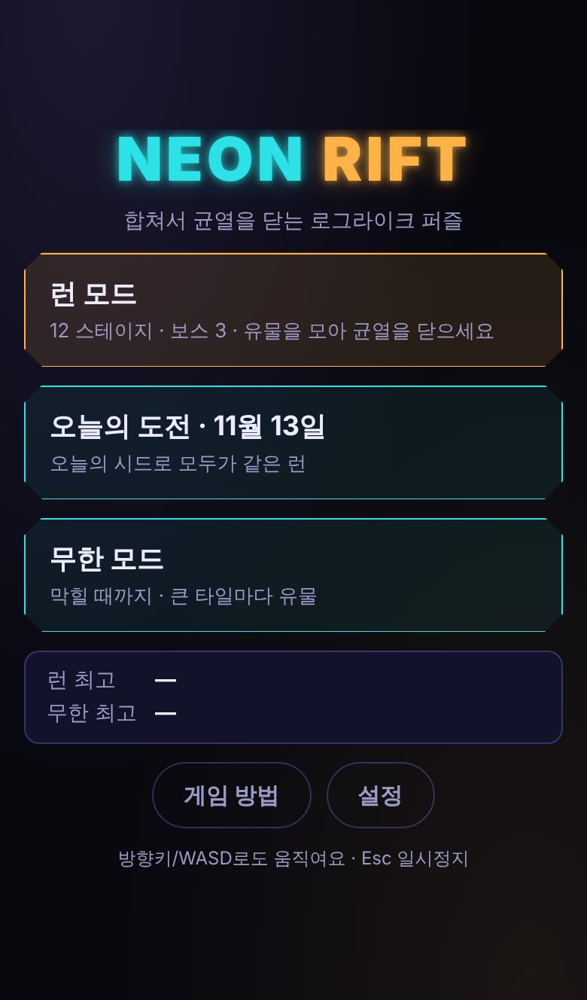
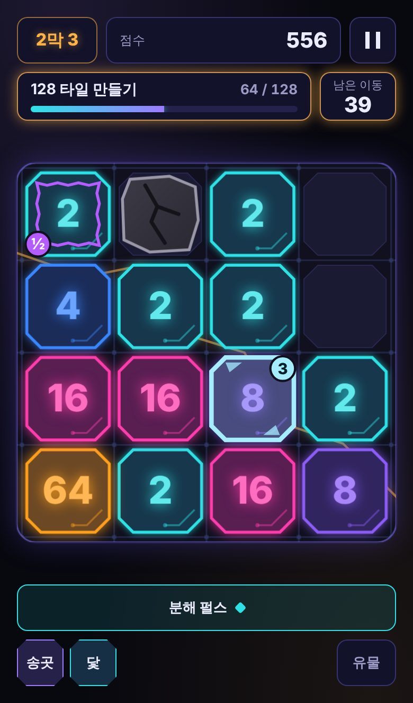
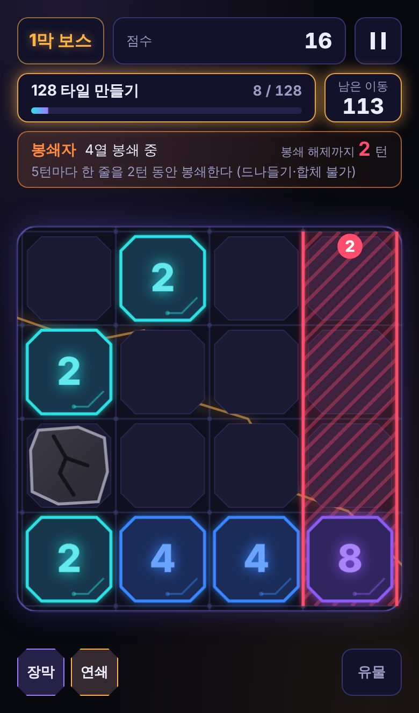
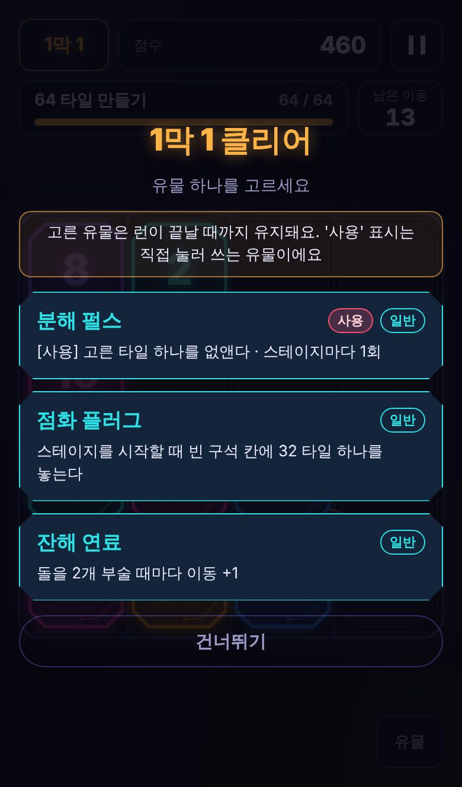
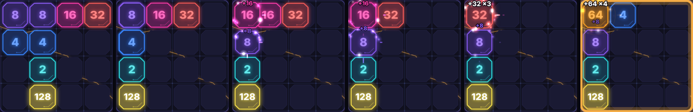
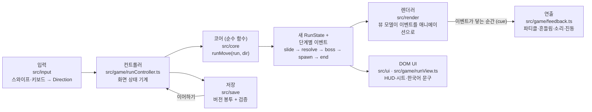

# Neon Rift (네온 리프트)

**2048의 밀어서 합치기에 방해 타일, 보스 규칙, 유물 빌드를 더한 모바일 로그라이크 퍼즐.**
설치 없이 브라우저에서 바로 하고, 홈 화면에 추가하면 오프라인으로도 됩니다.

▶ **플레이: https://dbsdlstn.github.io/2048-project/** (배포 후 접속 가능)

<table>
  <tr>
    <td></td>
    <td></td>
    <td></td>
    <td></td>
  </tr>
  <tr>
    <td align="center">메뉴</td>
    <td align="center">방해 타일 (돌·얼음·저주)</td>
    <td align="center">보스: 줄 봉쇄와 카운트다운</td>
    <td align="center">유물 선택</td>
  </tr>
</table>

연쇄 회로로 8+8 → 16 → 32 → 64가 한 번의 스와이프에 이어지는 장면 (시간을 멈추고 80~250ms 간격으로 찍은 프레임):



---

## 무엇이 다른가

**그냥 2048과 비교하면** 판이 끝없이 이어지지 않고, 이동 횟수가 정해진 **스테이지 12개**(3막 × 일반 3 + 보스 1)를 차례로 깹니다. 목표는 세 종류(타일 만들기 · 점수 · 돌 부수기)이고, 깰 때마다 **유물 3개 중 하나**를 골라 런이 끝날 때까지 들고 갑니다.

**같은 장르의 다른 게임과 비교하면**: 2048 로그라이크는 이미 있습니다(예: 상용작 _Numbers Go Up: The 2048 Roguelike_, 게이트·상점·타일 강화·생성 풀 조작이 중심). Neon Rift는 상점과 화폐 없이 아래 규칙들로 승부합니다.

- **대응할 수 있는 방해 타일**: 돌은 바로 옆에서 합체하면 부서지고, 얼음은 같은 수를 밀어 넣으면 깨지고, 저주는 한 번 쓰이면 사라집니다. 방해는 "운 나쁨"이 아니라 수를 읽어 풀어야 하는 퍼즐입니다.
- **카운트다운과 예고가 보이는 보스 규칙**: 봉쇄자는 몇 턴 뒤에 줄을 막는지, 부식자는 다음에 어느 타일을 깎는지 미리 보여 줍니다. 계산할 수 있는 정보는 화면에 둔다는 원칙입니다.
- **공유 숫자만 건드리는 유물**: 유물은 다른 유물을 이름으로 지목하지 않고 이동 제한, 합체 점수, 생성 확률, 보스 간격, 연쇄 깊이 같은 공통 숫자와 키워드(돌·얼음·저주·구석)만 바꿉니다. 그래서 따로 설계한 유물끼리 우연한 시너지가 납니다.
- **쓸모없는 선택지는 나오지 않음**: 남은 스테이지에 돌이 없으면 돌 관련 유물은 제시되지 않습니다.
- **오늘의 도전**: 날짜로 시드를 만들어 그날 모두가 같은 런을 합니다. 서버가 없습니다.
- **고유한 외형과 용어**: 깎인 모서리의 칩 타일, 회로 기판 보드, 그 아래를 지나는 주황 균열. 와일드 타일 대신 "프리즘", 유물 이름은 회로·코일·필터 세계관.

## 플레이 방법

- 화면 어디서나 **밀면**(또는 방향키·WASD) 모든 타일이 그쪽으로 미끄러지고, 같은 수끼리 부딪히면 합쳐집니다.
- 스테이지 목표를 이동 제한 안에 달성하면 클리어. 이동이 바닥나거나 더 움직일 수 없으면(구조 유물도 없으면) 런이 끝납니다.
- 보드는 스테이지마다 새로 시작하고, **유물과 누적 점수만** 이어집니다.
- `사용` 표시가 붙은 유물은 버튼을 눌러 직접 씁니다(타일 하나 없애기, 되돌리기, 얼려 고정하기).
- 첫 판에는 1막이 튜토리얼 역할을 합니다: 1-2에서 돌, 1-3에서 얼음, 2-1에서 저주를 처음 만납니다.

## 모드

| 모드        | 내용                                                                                        |
| ----------- | ------------------------------------------------------------------------------------------- |
| 런 모드     | 12 스테이지, 보스 3. 기본 모드                                                              |
| 오늘의 도전 | 런 모드와 같지만 시드가 날짜로 정해짐. 날짜별 최고 기록 저장                                |
| 무한 모드   | 막힐 때까지. 가장 큰 타일이 64, 128, 256…에 닿을 때마다 유물 선택, 이동할수록 방해가 늘어남 |

진행 중인 판은 매 이동마다 저장되어, 앱을 닫았다 열면 메뉴에서 **이어하기**로 정확히 같은 상태(난수 포함)에서 계속합니다.

## 규칙 표

아래 표는 게임 데이터에서 생성됩니다(`npm run readme`). 숫자를 바꾸고 표를 갱신하지 않으면 테스트가 실패합니다.

### 스테이지

<!-- generated:stages -->

| 스테이지 | 목표            | 이동 제한 | 방해             | 보스   |
| -------- | --------------- | --------- | ---------------- | ------ |
| 1-1      | 64 타일 만들기  | 70        | —                | —      |
| 1-2      | 돌 10개 부수기  | 55        | 돌               | —      |
| 1-3      | 64 타일 만들기  | 65        | 돌 · 얼음        | —      |
| 1-보스   | 128 타일 만들기 | 120       | 돌 · 얼음        | 봉쇄자 |
| 2-1      | 점수 700 달성   | 90        | 돌 · 얼음 · 저주 | —      |
| 2-2      | 돌 10개 부수기  | 60        | 돌 · 얼음 · 저주 | —      |
| 2-3      | 128 타일 만들기 | 105       | 돌 · 얼음 · 저주 | —      |
| 2-보스   | 점수 1050 달성  | 110       | 돌 · 얼음 · 저주 | 부식자 |
| 3-1      | 128 타일 만들기 | 105       | 돌 · 얼음 · 저주 | —      |
| 3-2      | 돌 16개 부수기  | 80        | 돌 · 얼음 · 저주 | —      |
| 3-3      | 점수 1500 달성  | 110       | 돌 · 얼음 · 저주 | —      |
| 3-보스   | 256 타일 만들기 | 170       | 돌 · 얼음 · 저주 | 혼돈   |

<!-- /generated:stages -->

### 방해 타일

<!-- generated:hazards -->

| 방해 | 규칙                                                                       | 처음 나오는 곳 |
| ---- | -------------------------------------------------------------------------- | -------------- |
| 돌   | 밀리지만 합쳐지지 않는다. 바로 옆에서 합체가 일어나면 부서진다             | 1-2            |
| 얼음 | 얼어붙은 타일은 몇 턴 동안 제자리에 고정된다. 같은 수를 밀어 넣으면 깨진다 | 1-3            |
| 저주 | 저주받은 타일이 끼는 합체는 결과가 절반이 된다 (한 번)                     | 2-1            |

<!-- /generated:hazards -->

### 보스

<!-- generated:bosses -->

| 보스   | 스테이지 | 규칙                                                   |
| ------ | -------- | ------------------------------------------------------ |
| 봉쇄자 | 1-보스   | 5턴마다 한 줄을 2턴 동안 봉쇄한다 (드나들기·합체 불가) |
| 부식자 | 2-보스   | 4턴마다 가장 큰 타일을 절반으로 깎는다                 |
| 혼돈   | 3-보스   | 5턴마다 보드를 뒤섞고 돌 1개를 놓는다                  |

<!-- /generated:bosses -->

### 유물 (16종)

<!-- generated:relics -->

| 유물        | 등급 | 종류 | 효과                                                                 |
| ----------- | ---- | ---- | -------------------------------------------------------------------- |
| 연쇄 회로   | 희귀 | 지속 | 합체로 생긴 타일이 같은 수와 맞닿으면 이어서 합체한다 (최대 2번)     |
| 공명 증폭기 | 고급 | 지속 | 한 이동에서 합체가 1번 더 날 때마다 그 이동의 합체 점수 +30%         |
| 균열 송곳   | 고급 | 지속 | 8 이상을 만든 합체는 대각선 이웃의 돌까지 부순다                     |
| 프리즘 코어 | 희귀 | 지속 | 12번 이동할 때마다 어떤 숫자와도 합쳐지는 프리즘 타일이 나온다       |
| 모서리 닻   | 일반 | 지속 | 네 구석 칸에서 일어난 합체는 점수 1.5배                              |
| 여분 태엽   | 일반 | 지속 | 모든 스테이지의 이동 제한 +6                                         |
| 분해 펄스   | 일반 | 사용 | 고른 타일 하나를 없앤다 · 스테이지마다 1회                           |
| 역행 코일   | 희귀 | 사용 | 직전 행동을 되돌린다 · 스테이지마다 1회                              |
| 정지 핀     | 고급 | 사용 | 고른 타일을 3턴 동안 얼려 고정한다 · 최대 2회, 스테이지마다 1회 충전 |
| 역상 필터   | 고급 | 지속 | 얼음이나 저주가 붙은 타일이 낀 합체는 점수 3배                       |
| 잔해 연료   | 일반 | 지속 | 돌을 2개 부술 때마다 이동 +1                                         |
| 쌍둥이 씨앗 | 고급 | 지속 | 새로 나오는 타일이 4일 확률 +10%                                     |
| 점화 플러그 | 일반 | 지속 | 스테이지를 시작할 때 빈 구석 칸에 32 타일 하나를 놓는다              |
| 지연 장막   | 고급 | 지속 | 보스 규칙의 발동 간격 +2턴                                           |
| 도약 렌즈   | 고급 | 지속 | 스테이지의 첫 3번 합체는 결과가 2배가 된다                           |
| 축전 코일   | 고급 | 지속 | 합체 8번마다 사용 유물의 충전 +1                                     |

<!-- /generated:relics -->

## 기술적으로 볼 만한 것

### 구조: 순수한 코어, 이벤트를 재생하는 화면



- **규칙을 판단하는 곳은 코어 한 곳**입니다. [`src/core`](src/core)는 DOM·시간·난수 전역 상태를 모르고, `runMove(run, dir)`가 새 상태와 **단계(phase)별 이벤트 목록**을 돌려줍니다([`turn.ts`](src/core/turn.ts), [`run.ts`](src/core/run.ts)). 상태는 평범한 불변 데이터라 JSON으로 저장하면 난수 흐름까지 그대로 이어집니다.
- **화면은 규칙을 다시 계산하지 않습니다.** 렌더러의 뷰 모델([`viewModel.ts`](src/render/viewModel.ts))이 이벤트를 차례로 재생해 애니메이션을 만들고, 연출 계층([`feedback.ts`](src/game/feedback.ts))은 "사건 → 파티클·흔들림·소리·진동" 매핑 표 하나로 이벤트에 반응합니다.
- **재생 동등성 테스트**: 이전 보드에 이벤트만 적용하면 코어의 새 보드와 같아야 합니다([`tests/board.test.ts`](tests/board.test.ts) 300턴, 단계별 인과 검사 [`tests/helpers.ts`](tests/helpers.ts) `replayPhases`). 실제 뷰 모델로도 400턴 동안, 애니메이션 도중에 다음 턴을 끼워 넣으며 같은지 확인합니다([`tests/viewModel.test.ts`](tests/viewModel.test.ts)).
- **주입 가능한 시계와 디버그 훅**: 렌더러는 `performance.now()`를 직접 부르지 않고 시계를 주입받습니다([`clock.ts`](src/render/clock.ts)). `?debug`로 열면 `window.__neonRift`([`debug.ts`](src/game/debug.ts))가 시간을 멈추고 ms 단위로 넘기며, 정확한 보드를 불러올 수 있어 스크린샷·연출 검사·e2e 테스트가 결정적입니다. 플래그 없이는 아무것도 노출되지 않습니다.
- **스프라이트 캐시와 프레임 예산**: 글로우는 `shadowBlur`를 매 프레임 쓰지 않고 타일 모습별로 미리 그려 둡니다([`spriteCache.ts`](src/render/spriteCache.ts)). 움직이는 프레임의 길이를 재서 파티클 밀도를 정합니다([`budget.ts`](src/render/budget.ts)). 최악의 턴(합체 8번 + 보스 발동)을 headless Chromium에서 잰 프레임 간격(ms, 평균 / p95):

  | CPU     | 연출 추가 전 | 연출 추가 후 | 렌더러 tick 평균 |
  | ------- | ------------ | ------------ | ---------------- |
  | 1×      | 17.0 / 16.8  | 16.7 / 16.7  | 0.29             |
  | 4× 느림 | 30.0 / 83.3  | 23.9 / 33.4  | 1.53             |
  | 6× 느림 | 53.1 / 133.4 | 37.2 / 50.1  | 3.06             |

  소프트웨어 래스터 기준의 비교용 숫자이고 실제 휴대폰에서 잰 값은 아닙니다(자세한 내용은 [학습 노트 7.11](docs/STUDY.md#711-프레임-시간-측정과-성능-예산)).

- **시뮬레이션으로 잡은 밸런스**: 코어가 순수 함수라 봇이 수백 판을 몇십 초에 돌립니다([`tools/simulate.ts`](tools/simulate.ts), `npm run sim`). 무작위·탐욕·"구석" 봇(1수 앞을 보는 휴리스틱)으로 스테이지별 클리어율, 실패 원인, 유물별 승률 차이를 보고 [`balance.ts`](src/core/balance.ts)의 숫자만 고칩니다. 현재 값(500판, 시드 1000~1499):

  | 지표                                         | 목표     | 결과                       |
  | -------------------------------------------- | -------- | -------------------------- |
  | 구석 봇 승률                                 | 15~30%   | 23%                        |
  | 구석 봇 1막 통과                             | 95% 이상 | 93% (미달, 아래 한계 참고) |
  | 무작위 봇 1막 통과                           | 10% 이하 | 12% (미달)                 |
  | 유물을 하나도 안 고르는 구석 봇 승률         | 0%       | 0%                         |
  | 2막 보스(점수) 클리어, 점수 유물 있음 / 없음 | 긴장감   | 90% / 43%                  |

- **버전 있는 저장**: 값마다 `{ schema: n, ... }` 봉투와 필드 단위 검증·대체값, 한 단계씩 올리는 마이그레이션, 더 새 버전이 쓴 값은 덮어쓰지 않는 규칙([`schema.ts`](src/save/schema.ts), [`validate.ts`](src/save/validate.ts), [`store.ts`](src/save/store.ts)). 저장소는 주입하므로 사생활 보호 모드에서는 메모리로 돌아갑니다.
- **직접 쓴 PWA**: 서비스 워커는 플러그인 없이 주석 포함 80줄([`sw.ts`](src/pwa/sw.ts)), 빌드 파일 목록과 내용 해시는 작은 Vite 플러그인이 넣습니다([`vite-precache.ts`](tools/vite-precache.ts)). 새 버전은 플레이어가 "새로고침"을 누를 때만 적용됩니다([`register.ts`](src/pwa/register.ts)).
- **런타임 의존성 0**: `package.json`에 `dependencies`가 없습니다. 소리는 WebAudio로 합성하고, 아이콘과 공유 이미지도 코드로 그립니다([`tools/icons.ts`](tools/icons.ts)). 빌드 결과: JS 134 KB (gzip 46 KB), CSS 18 KB (gzip 4.6 KB), 오프라인용으로 미리 받는 파일 합계 약 212 KB.
- **테스트**: Vitest 단위 테스트 21개 파일 · 318개(코어 규칙, 유물 훅, 보스, 저장 마이그레이션, 뷰 모델 동기화, 연출 매핑, 오디오 스케줄링, 업데이트 흐름…) + Playwright e2e 2개(실제 스와이프 → 1-1 클리어 → 유물 선택 → 새로고침 후 이어하기가 같은 상태인지, 오프라인 새로고침 후에도 플레이되는지). 규칙 표가 코드와 어긋나면 테스트가 실패합니다.

## 실행과 개발

Node 22.13 이상(Vitest 5와 ESLint 10의 요구 사항, `package.json`의 `engines`). CI는 Node 22.

```bash
npm ci
npm run dev          # 개발 서버 (http://localhost:5173/2048-project/)
npm run build        # 타입 검사 + 프로덕션 빌드 (dist/)
npm run preview      # 빌드 결과 미리보기 (서비스 워커 포함)

npm run test         # 단위 테스트 (Vitest)
npm run e2e          # 빌드 후 휴대폰 화면 크기로 e2e (Playwright)
npm run lint         # ESLint (typescript-eslint strictTypeChecked)
npm run format:check # Prettier

npm run sim          # 밸런스 봇 시뮬레이션 (-- --runs 1000, -- --bots corner)
npm run readme       # README의 규칙 표 갱신
npm run icons        # 아이콘·공유 이미지 다시 그리기
npm run media        # README 스크린샷 다시 찍기 (먼저 npm run build)
```

e2e를 처음 돌릴 때는 `npx playwright install chromium`이 필요합니다(미리 설치된 Chromium이 `/opt/pw-browsers/chromium`에 있거나 `PW_CHROMIUM_PATH`로 지정하면 그것을 씁니다).

URL 옵션: `?seed=문자열`(첫 판 시드), `?mode=run|endless`, `?stage=N`, `?relics=chain,bomb`, `?debug`(테스트용 훅).

## 프로젝트 구조

```
src/
  core/     규칙 전부. 순수 함수, DOM 없음 (보드, 방해, 보스, 유물, 스테이지, 런 상태 기계, 시드 RNG)
  render/   Canvas 렌더러: 뷰 모델, 트윈, 스프라이트 캐시, 파티클, 흔들림, 프레임 예산
  game/     컨트롤러(화면 상태 기계), 프레젠터(runView), 연출 매핑(feedback), 오늘의 도전, 디버그 훅
  ui/       DOM: HUD, 메뉴·유물 선택·결과 시트, 업데이트 안내
  input/    포인터 스와이프, 키보드, 진동
  audio/    WebAudio 합성 효과음
  save/     localStorage 저장: 스키마, 검증, 마이그레이션
  pwa/      서비스 워커와 업데이트 흐름
tests/      Vitest 단위 테스트
e2e/        Playwright 스모크 테스트
tools/      시뮬레이터, 아이콘·스크린샷·README 표 생성, 프리캐시 Vite 플러그인
public/     매니페스트, 생성된 아이콘
docs/       STUDY.md(학습 노트), RESEARCH.md(외부 자료 조사), media/(README 이미지)
.github/workflows/  ci.yml(검사), deploy.yml(GitHub Pages 배포)
```

## 문서

- [**docs/STUDY.md**](docs/STUDY.md): 이 프로젝트를 교재 삼아 게임 개발을 공부하는 학습 노트. 개념마다 "왜 필요한가 → 어디에 쓰였나 → 핵심 코드 → 연습 과제", 설계 결정 기록, 코드 읽는 순서.
- [**docs/RESEARCH.md**](docs/RESEARCH.md): 참고한 외부 자료와 각 자료를 어디에 반영할지의 판정.

## 한계와 다음 단계

- **실기기 검증이 없습니다.** 모든 확인은 데스크톱 Chromium의 휴대폰 화면 크기 에뮬레이션에서 했습니다. iOS Safari, 저가형 안드로이드에서의 프레임 시간과 설치 동작은 아직 못 봤습니다.
- **소리와 진동은 귀와 손으로 확인하지 않았습니다.** 소리는 오프라인 렌더링으로 크기·겹침을 숫자로만 쟀습니다. iOS Safari는 진동 API가 없어 진동이 나지 않습니다(설정에서 스위치가 숨겨짐).
- **밸런스는 봇 기준입니다.** 봇은 사용 유물 중 일부(정지 핀)를 쓰지 않고, 되돌리기는 막혔을 때만 써서 그런 유물의 가치를 낮게 잽니다. 1막 목표(구석 봇 95% 이상, 무작위 봇 10% 이하)는 둘 다 1막 보스에서 "막힘"으로 지는 비율이 결정해 서로 부딪힙니다. 사람 플레이 테스트로 다시 맞춰야 합니다.
- **GitHub Actions 워크플로는 이 저장소에서 아직 실행해 보지 않았습니다.**
- 다음에 해 볼 것: 실기기 프레임 측정, 사람 플레이 테스트 기록으로 밸런스 재조정, 시드 공유 링크, 유물 도감.

## 개발 방식

설계 방향과 결정은 저장소 주인이 정하고, 구현은 AI 코딩 에이전트와 함께 **관리자 → 작업자** 루프로 진행했습니다. 관리 세션이 단계별 범위와 완료 기준을 지시하면 작업 세션이 구현해 보고하고, 관리 세션이 테스트·빌드·브라우저 확인으로 검증한 뒤 커밋했습니다. 단계마다의 결정과 이유는 [학습 노트의 설계 결정 기록](docs/STUDY.md#10-설계-결정-기록)에 남아 있습니다.

## 라이선스

아직 정하지 않았습니다.
